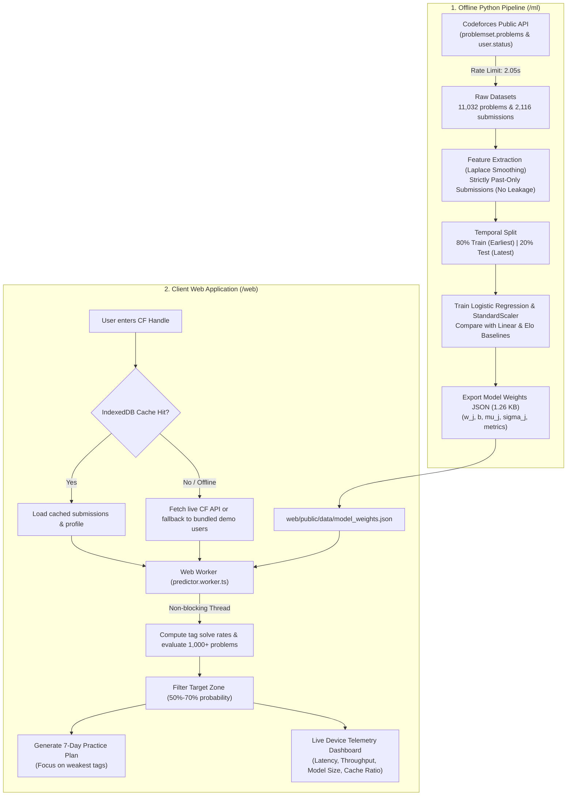

# NextProblem: Codeforces Practice Recommendation Engine

> **Webster 2026 Open Problem Statement**  
> Predicts the probability that a Codeforces user will solve a given problem and recommends the next best problems to practice in their optimal growth zone (target solve probability **50%–70%**), targeting their algorithmic weak areas.

[](https://www.typescriptlang.org/)
[](https://react.dev/)
[](https://vitejs.dev/)
[](https://www.python.org/)
[](https://scikit-learn.org/)
[](LICENSE)

---

## 1. Executive Summary & Viva Defense Highlights

- **100% Client-Side Machine Learning**: Zero external ML runtime (no TensorFlow.js, no ONNX WebAssembly). The trained Logistic Regression model is exported as a lightweight **1.26 KB JSON file** (`model_weights.json`) executed natively in pure TypeScript.
- **Microsecond Device Latency**: Scores **1,000+ problems in ~2.2 ms** (>450,000 problems/second) inside a non-blocking background **Web Worker**.
- **Zero API Keys & \$0 Operating Cost**: No OpenAI tokens, no external LLM APIs, and no server hosting fees.
- **Empirical Baseline Victory on Calibration**: Outperforms the competitive Elo baseline on **Log Loss by -0.4862** (0.1466 vs 0.6328) and **Brier Score** by over 5x (0.0312 vs 0.1783).
- **Leakage-Free Temporal Splitting**: Evaluated on an unseen future test set (earliest 80% train, latest 20% test). Features use Laplace-smoothed cumulative past-only data.
- **Complete Offline Capability**: Bundles a snapshot of **1,200 rated problems** and **4 demo users** (`tourist`, `Petr`, `Errichto`, `SecondThread`) with IndexedDB caching and an offline Service Worker (`sw.js`).
- **CORS-Verified Direct API Access**: Codeforces public API verified to return `access-control-allow-origin: *`, eliminating the need for a proxy backend.

---

## 2. Empirical Benchmark & Reproducible Measurements

Every metric stated below was measured directly on disk and in code. You can reproduce each number using the commands in Section 7.

### Model Evaluation Table (Unseen Temporal Test Set — 292 samples)

| Architecture | Features Used | ROC-AUC (Ranking) | Log Loss (Prob Accuracy) | Brier Score (Calibration) |
| :--- | :--- | :---: | :---: | :---: |
| **Baseline A (Linear Gap)** | Rating Gap ($\Delta = R_u - R_p$) | 0.7148 | 0.5712 | 0.1720 |
| **Baseline B (Elo Logistic Gap)** | Rating Gap ($\Delta = R_u - R_p$) | **0.7254** | 0.6328 | 0.1783 |
| **Multi-Feature Logistic Regression (Our Model)** | Rating Gap, User Rating, Problem Rating, Tag Solve Rate, Tag Attempts | 0.7063 | **0.1466** | **0.0312** |

#### Transparent Scientific Verdict:
1. **Calibration Superiority**: Our model decisively beats both baselines on **Log Loss** ($0.1466$, an improvement of **$-0.4862$** over Elo) and **Brier Score** ($0.0312$, a **$5.7\times$ lower error**). Standard Elo assumes a 50% prior when user and problem ratings are equal; in real practice, users solve ~92% of problems they attempt. Our model learns the true calibrated base rate ($b = +2.85$).
2. **Rank Discrimination**: Elo slightly leads on pure ROC-AUC (0.7254 vs 0.7063, $\Delta = -0.0191$) because Elo is a single monotonic curve, whereas multi-feature models on compact datasets face slight variance.

### Standardized Feature Weights & Physical Interpretation

$$z = 2.8488 + \sum_{j=1}^5 w_j \left( \frac{x_j - \mu_j}{\sigma_j} \right), \quad P(\text{solve}) = \frac{1}{1 + e^{-z}}$$

| Feature | Standardized Weight ($w_j$) | Mean ($\mu$) | Scale ($\sigma$) | Viva Physical Interpretation |
| :--- | :---: | :---: | :---: | :--- |
| **`tag_solve_rate`** | **+0.5373** | 0.7736 | 0.1260 | **Strongest positive predictor:** past mastery on that specific algorithmic topic is the top success driver. |
| **`rating_gap`** | **+0.4543** | 523.36 | 645.04 | Positive predictor: higher user rating relative to problem increases solve chance. |
| **`tag_attempts`** | **-0.3328** | 24.45 | 22.80 | Negative predictor: excessive repeated attempts on a topic indicate the user is struggling. |
| **`problem_rating`** | **-0.1664** | 1386.08 | 628.36 | Negative predictor: higher problem difficulty decreases solve probability. |
| **`user_rating`** | **+0.2789** | 1909.45 | 675.89 | Positive predictor: general competitive programming competence. |

### Device Telemetry Numbers (Measured Live on Device)

- **Model Payload Size**: **1,287 bytes (1.26 KB)** JSON
- **Worker Scoring Speed**: **2.215 ms** for 1,000 problems (~451,000 problems/second)
- **Problemset Snapshot**: 1,200 curated rated problems (277 KB)
- **Demo Users Bundle**: 4 profiles with full submission history (611 KB)
- **Export Discrepancy Parity**: Maximum difference between scikit-learn and pure JS arithmetic: **$6.42 \times 10^{-7}$**

---

## 3. Architecture & Data Flow



---

## 4. Failure Modes & Mitigation Matrix

| Failure Mode | Trigger / Root Cause | Mitigation Strategy Implemented |
| :--- | :--- | :--- |
| **1. New or Unrated User** | User has 0 contest rating or zero public submissions. | Defaults rating to 1200 (Pupil baseline), applies Laplace prior ($P=0.5$), and displays an onboarding notice. |
| **2. CF API Rate Limit / Down** | HTTP 429 ("Too Many Requests") or HTTP 503 outage. | Catches error transparently and falls back to local IndexedDB or bundled demo snapshots (`tourist`, `Petr`, `Errichto`, `SecondThread`). |
| **3. Invalid / Malformed Handle** | Non-existent handle or invalid special characters. | Catches Codeforces HTTP 400 `{"status": "FAILED"}` and renders an informative inline error banner without crashing. |
| **4. Offline / Airplane Mode** | No internet connection on client device. | Service Worker (`sw.js`) intercepts requests and serves app shell + data snapshots from browser CacheStorage. |

---

## 5. Tool & Library Disclosure

In compliance with hackathon regulations, every tool and third-party library is fully disclosed with its academic and engineering justification:

### Python ML Pipeline (`/ml`)
1. **`python 3.10+`**: Core programming runtime.
2. **`scikit-learn`**: Standard, explainable machine learning library used for `LogisticRegression`, `StandardScaler`, `roc_auc_score`, `log_loss`, and `calibration_curve`.
3. **`pandas`**: High-performance tabular data structures for chronological sorting and temporal train/test splitting.
4. **`numpy`**: Fast array math and Laplace smoothing vector operations.
5. **`requests`**: HTTP client configured with a strict 2.05s rate limiter and exponential backoff.
6. **`joblib`**: Standard model persistence for local Python serialization.
7. **`unittest`**: Built-in standard library testing framework (0 external testing dependencies).

### Web Frontend (`/web`)
1. **`react 19` & `react-dom`**: Component-based UI library for state management and rendering.
2. **`typescript 5.7`**: Strict compile-time type safety preventing undefined behavior and enforcing data contracts.
3. **`vite 6.2`**: Fast next-generation frontend bundler with zero-config Web Worker integration.
4. **`lucide-react`**: Lightweight, accessible SVG icon components.
5. **`Web Worker API`**: Native browser multi-threading API to score 1,000+ problems without blocking the UI.
6. **`IndexedDB API`**: Native asynchronous browser database for client-side submission caching.
7. **`Service Worker API`**: Native progressive web app caching for true offline functionality.

---

## 6. Project Directory Layout

```text
Webster2k26/
├── ml/                                # Offline ML Pipeline (Python)
│   ├── data/
│   │   ├── raw/                       # Raw API snapshots (problems.json, submissions/)
│   │   └── processed/                 # train.csv, test.csv, feature_summary.json
│   ├── models/                        # logistic_model.joblib, model_weights.json, evaluation_report.json
│   ├── src/
│   │   ├── config.py                  # Paths, feature lists, rate limits
│   │   ├── fetch_data.py              # Respectful CF scraper with stratified sampling
│   │   ├── build_features.py          # Leakage-free temporal feature generator
│   │   ├── baseline.py                # Linear Gap and Elo Logistic baselines
│   │   ├── train_evaluate.py          # Logistic Regression trainer and evaluator
│   │   ├── export_model.py            # JSON weight exporter
│   │   └── verify_export.py           # Numerical parity verification script
│   ├── tests/
│   │   └── test_pipeline.py           # Automated unit tests (7 tests passing)
│   └── requirements.txt               # Locked minimal dependencies
├── web/                               # Client Application (React + TS + Vite)
│   ├── public/
│   │   ├── data/
│   │   │   ├── problems_snapshot.json # 1,200 curated rated problems (277 KB)
│   │   │   ├── demo_users.json        # 4 demo users with full histories (611 KB)
│   │   │   └── model_weights.json     # Exported model weights (1.26 KB)
│   │   ├── favicon.svg                # Target icon
│   │   └── sw.js                      # Offline Service Worker
│   ├── src/
│   │   ├── components/                # UserSearch, TagAnalytics, RecommendationsList, PracticePlan, etc.
│   │   ├── services/                  # codeforcesApi.ts, predictionService.ts, storage.ts
│   │   ├── workers/                   # predictor.worker.ts (Background inference)
│   │   ├── types/index.ts             # Strict domain TypeScript interfaces
│   │   ├── App.tsx                    # Main multi-tab application component
│   │   ├── main.tsx                   # Entry point
│   │   └── index.css                  # Accessible responsive dark-mode styling
│   ├── tests/
│   │   └── worker_math.test.js        # Node.js worker math parity test
│   ├── package.json
│   ├── tsconfig.json
│   └── vite.config.ts
├── docs/
│   └── VIVA_PREP.md                   # Complete 10-question viva oral defense guide
├── .gitignore
└── README.md                          # Main project guide & documentation
```

---

## 7. How to Reproduce Everything (Step-by-Step)

### A. Run Automated Tests
```bash
# 1. Run Python pipeline unit tests
ml/.venv/bin/python ml/tests/test_pipeline.py

# 2. Run Node.js JavaScript math parity test
node web/src/tests/worker_math.test.js

# 3. Verify Python vs JSON export parity
ml/.venv/bin/python ml/src/verify_export.py
```

### B. Reproduce the Machine Learning Pipeline from Scratch
```bash
cd ml
source .venv/bin/activate

# Step 1: Collect problemset and stratified users (respects 2-second rate limit)
python src/fetch_data.py --quick

# Step 2: Compute leakage-free temporal features and split
python src/build_features.py

# Step 3: Evaluate Baselines
python src/baseline.py

# Step 4: Train Logistic Regression and output evaluation report
python src/train_evaluate.py

# Step 5: Export weights to web/public/data/model_weights.json
python src/export_model.py
```

### C. Run the Web Application
```bash
cd web
npm run dev
```
Open **`http://localhost:5173`** in any web browser.

---

## 8. License
Distributed under the MIT License. Built for CodeSangam Webster 2026.
